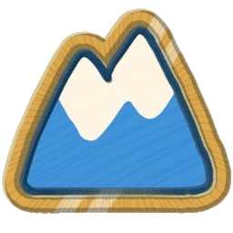

<p align="center">
  
</p>

<h1 align="center">PEAK Passport Maker</h1>

<p align="center">make your own little scout passport 🏔️🎒</p>

---

Upload your scout pic, write your name, pick your ascent sash, stamp the biomes you've climbed, and download a cozy PNG passport to show off.

## ✨ What you can do

- 📸 **Upload a photo**: drag, drop, or paste. Drag to move it and scroll to zoom.
- 🪪 **Fill in your ID**: name, passport no., nationality (CRABLAND, obviously), and date of issue.
- 🎀 **Pick your ascent**: the badge takes your sash color, from Tadpole all the way to Scoutmaster.
- 🗺️ **Collect stamps**: Shore, Tropics, Roots, Alpine, Mesa, Caldera, Gloom, The Kiln, The Citadel, Peak, plus the secret Tomb and Nadir 👀
- 💾 **Download or copy** your finished passport as a PNG.

## 🧗 Run it

No build step and nothing to install. Just open `index.html` in your browser.

```sh
git clone https://github.com/mmvergara/peak-passport.git
cd peak-passport
open index.html   # or xdg-open on linux
```

## 🍃 Notes

Your photo never leaves your browser. Nothing gets uploaded anywhere.

Unofficial fan project, made with love. Not affiliated with Aggro Crab or Landfall. PEAK and its art belong to them.

<p align="center">see you at the summit 🏁</p>
